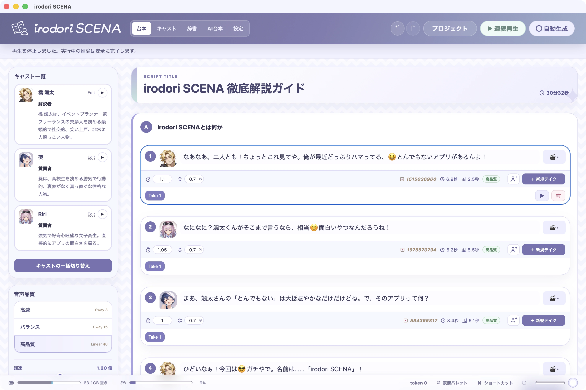
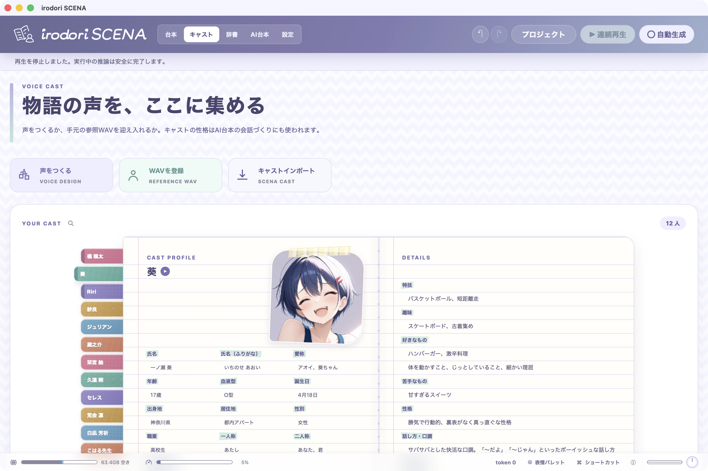
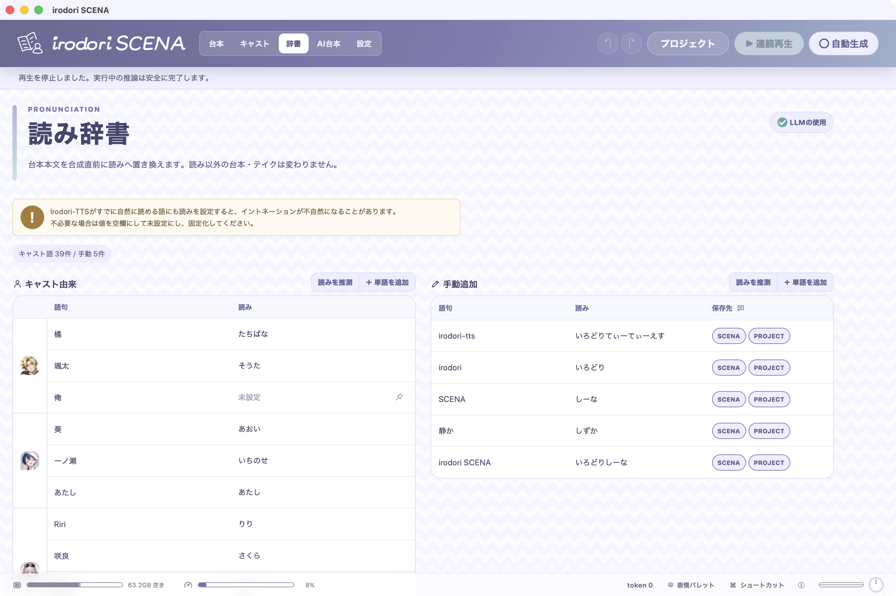
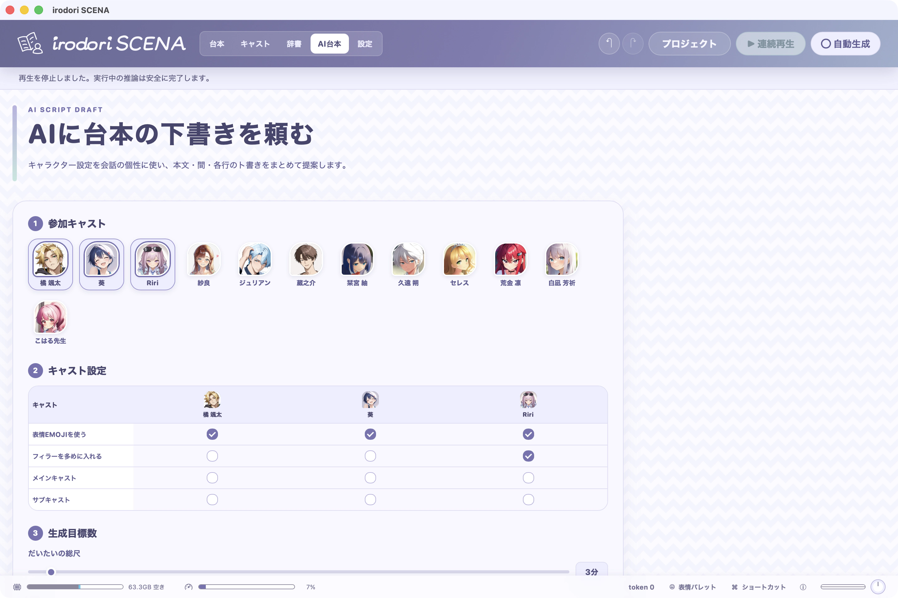
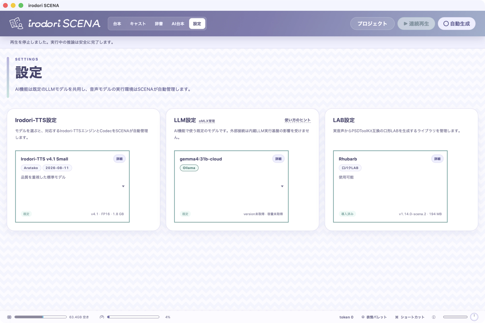

# irodori SCENA

[](LICENSE)
[](#動作環境)
[](https://github.com/NJ1216/irodori-scena/releases/latest)

日本語の台本を書いて、キャラクターごとの声で読み上げ音声を作るアプリです。ボイスドラマや掛け合いの台詞づくりに使えます。音声は [Irodori-TTS](https://github.com/Aratako/Irodori-TTS) を使い、自分のパソコンの中で作ります。



WindowsとMacで使えるベータ版です。Windows版はインストーラーを配布します。Mac版は完成したアプリを配布しないため、ソースコードから各自でビルド（アプリを組み立てること）して使います。自動更新はありません。

## 動作環境

|  | Windows | Mac |
| --- | --- | --- |
| 入手方法 | インストーラー | 自分でビルド |
| 対象 | Windows 11（64ビット） | Apple Silicon搭載のMac |
| 音声の生成 | NVIDIAのGPU（GeForce GTX 16シリーズ・RTX 20シリーズ以降）を使います。対応するGPUがなければCPUで作るため、時間がかかります。 | MacのGPUを使います。 |

どちらも、最初にモデルなどを取得するため、インターネット接続と十分な空き容量が必要です。必要なメモリ量や空き容量の目安は、まだ決めていません。

作者が動作を確かめた環境は次のとおりです。これ以外の環境では動かない場合があります。

- Windows 11 Pro、NVIDIA GeForce RTX 4070 Ti（12GB）
- Windows 11 Pro、NVIDIAのGPUなし（CPUで生成）
- macOS 26.7、Apple M4 Max

## できること

- **台本：** 台詞ごとに話す人と演技の指示（ト書き）を書き、音声を作ります。気に入るまで何度でも作り直せて、前に作った音声と聞き比べられます。
- **キャスト：** 声の特徴を言葉で書くと、声の候補が作られます。気に入った声をキャラクターとして保存できます。

  

- **辞書：** 読み間違えやすい言葉の読み方を登録できます。

  

- **AI台本：** 登場人物とテーマを選ぶと、AI（LLM）が台本の下書きを書きます。中身を確認・修正してから台本に入れます。

  

- **書き出し：** 作った音声をWAVファイルに書き出せます。字幕、台本のテキスト、口の動きを合わせるためのデータ（口パクLAB）も一緒に書き出せます。

## 生成の速さ

音声を作る処理は、Irodori-TTSをそのまま使う場合より速くなるよう調整しています。声や音は変わりません。

| | 速さ | 測った環境 |
| --- | --- | --- |
| Windows（NVIDIAのGPU） | 約2〜3.7倍速い | GeForce RTX 4070 Ti、W8A16モデル |
| Mac | 生成時間が約1〜2割短い（短い台詞ほど効果が大きく、最大で約3割5分） | Apple M4 Max、MLX FP16モデル |

速さは台詞の長さや品質の設定、パソコンの状態によって変わります。CPUで生成する場合は、この速さにはなりません。

## Windowsにインストールする

1. [Releases](https://github.com/NJ1216/irodori-scena/releases) から `irodori SCENA_<バージョン>_x64-setup.exe` を入手します。
2. ダブルクリックして、画面の案内に従ってインストールします。

インストーラーには発行元の署名がないため、「WindowsによってPCが保護されました」と表示されることがあります。その場合は「詳細情報」を押し、「実行」を選んでください。

## Macでビルドする

### 1. 必要なツールを入れる

「ターミナル」アプリを開き、次のツールを順にインストールします。すでに入っているものは飛ばしてかまいません。

1. **Xcode Command Line Tools**（Appleの開発用の基本ツール。Gitも含まれます）

   ```bash
   xcode-select --install
   ```

2. **Rust**（アプリ本体のビルドに使うプログラミング言語）。画面の案内に従い、標準の設定でインストールします。

   ```bash
   curl --proto '=https' --tlsv1.2 -sSf https://sh.rustup.rs | sh
   ```

3. **Node.js**（画面部分のビルドに使います）。24以降が必要で、最新のLTS版をおすすめします。[Node.jsの公式サイト](https://nodejs.org/ja)からインストーラーを入手し、インストールします。

4. **pnpm**（Node.js用のパッケージ管理ツール）。11以降が必要で、最新版をおすすめします。

   ```bash
   npm install -g pnpm@latest
   ```

5. **uv**（Python用のパッケージ管理ツール）。バージョンは問いません。ビルドに必要なuv 0.12.5とPython 3.13.12は、ビルド時に自動で用意されます。

   ```bash
   curl -LsSf https://astral.sh/uv/install.sh | sh
   ```

すべてインストールしたら、ターミナルを一度閉じて開き直してください。

### 2. ソースコードを取得する

```bash
git clone https://github.com/NJ1216/irodori-scena.git
cd irodori-scena
```

### 3. ビルドする

```bash
uv python install 3.13.12
pnpm install --frozen-lockfile
uv sync --dev --group bundle --locked
pnpm tauri build
```

必要なパッケージをダウンロードするため、インターネット接続が必要です。初回は時間がかかります。最後に `Removed intermediate .app; verified DMG retained` と表示されれば完了です。

できあがったファイルは次の場所にあります。

```text
src-tauri/target/aarch64-apple-darwin/release/bundle/dmg/irodori SCENA_<バージョン>_AppleSilicon.dmg
```

同じバージョンのDMGがすでにある場合は、上書きせずに停止します。作り直すときは、古いDMGを先に削除してください。

### 4. インストールする

1. できあがったDMGをダブルクリックして開きます。
2. 「irodori SCENA」を「アプリケーション」フォルダーへドラッグします。
3. 「アプリケーション」フォルダーから起動します。

このアプリはAppleの確認（公証）を受けていません。自分でビルドしたものはそのまま開けますが、DMGを他のMacへ渡して開くと「“irodori SCENA”は開いていません」と表示されます。その場合は、次の手順で開きます。

1. 表示された画面で「完了」を押します。「ゴミ箱に入れる」は押さないでください。
2. 「システム設定」→「プライバシーとセキュリティ」を開き、いちばん下の「セキュリティ」まで進みます。
3. 「このまま開く」を押し、Macのログインパスワードを入力します。

「このまま開く」は、アプリを一度開こうとしてから約1時間だけ表示されます。見当たらない場合は、もう一度アプリを開こうとしてから設定を開いてください。一度許可すると、次からは普通に開けます。

## はじめて使うとき

1. 起動すると「生成機能の準備」が開きます。「推奨モデルをダウンロード」を押し、音声を作るためのモデルと実行環境をインストールします。大きなファイルを取得するため、インターネット接続と十分な空き容量が必要です。
2. AI台本などのAI機能を使う場合は、「LLM設定を開く」から設定します。自分のパソコンで動かすLLMをインストールするか、外部のLLMサービスの接続先を設定します。AI機能を使わない場合、この手順は不要です。
3. 「キャスト」でキャラクターの声を用意し、「台本」で台詞を書いて音声を作ります。

あとから変更するときは「設定」タブを使います。モデルの追加や削除もここでできます。



## データの保存場所とアプリの削除

設定やダウンロードしたモデルは次の場所に保存されます。

- Windows：`%APPDATA%\irodori-SCENA`
- Mac：`~/Library/Application Support/irodori-SCENA/`

プロジェクトは、保存時に自分で選んだ場所に保存されます。プロジェクトには音声も含まれます。

- **Windows：** 「設定」→「アプリ」から削除します。削除時に、設定・モデル・認証情報までまとめて消すか、再インストールに備えて残すかを選べます。自分で選んだ場所に保存したプロジェクトや、書き出したファイルは消えません。
- **Mac：** 必要なプロジェクトを控えておき、アプリの「設定」で認証情報（APIキーなど）を削除してから、アプリをゴミ箱へ入れてください。

## 外部への送信について

音声はパソコンの中で作ります。外部のLLMサービスを設定した場合だけ、AI機能に必要な台本やキャスト情報がその接続先へ送信されます。その際は、そのサービスの料金と利用条件が適用されます。APIキーはプロジェクトファイルには保存しません。

## モデルの利用条件

モデルや推論エンジンなどはアプリに含まれておらず、それぞれの配布元の利用条件が適用されます。ダウンロード前に確認してください。たとえば Irodori-TTS v4 Large（量子化版を含む）は [Gemma Terms of Use](https://ai.google.dev/gemma/terms) に従います。本体のMITライセンスは、モデルの条件や、声・入力素材などの第三者の権利を置き換えるものではありません。

## ライセンスと問い合わせ

本体はMITライセンスです。利用条件は [LICENSE](LICENSE)、第三者の表記は [THIRD_PARTY_NOTICES.md](THIRD_PARTY_NOTICES.md)、詳しい説明は [ライセンスについて](docs/public/licensing.md) にあります。アプリのフッターの「バージョン情報」からも確認できます。

不具合の報告や質問は [GitHub Issues](https://github.com/NJ1216/irodori-scena/issues) へお願いします。

## 開発者向け

ビルドの仕組み、公開準備、開発と検証の手順は [ビルドとデータ管理](docs/public/build.md) にあります。Windowsでの開発は [Windowsネイティブ開発](docs/public/windows-development.md) を参照してください。
